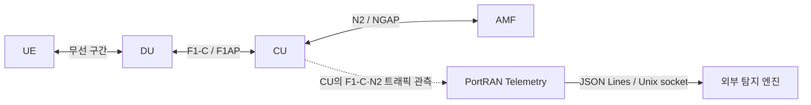
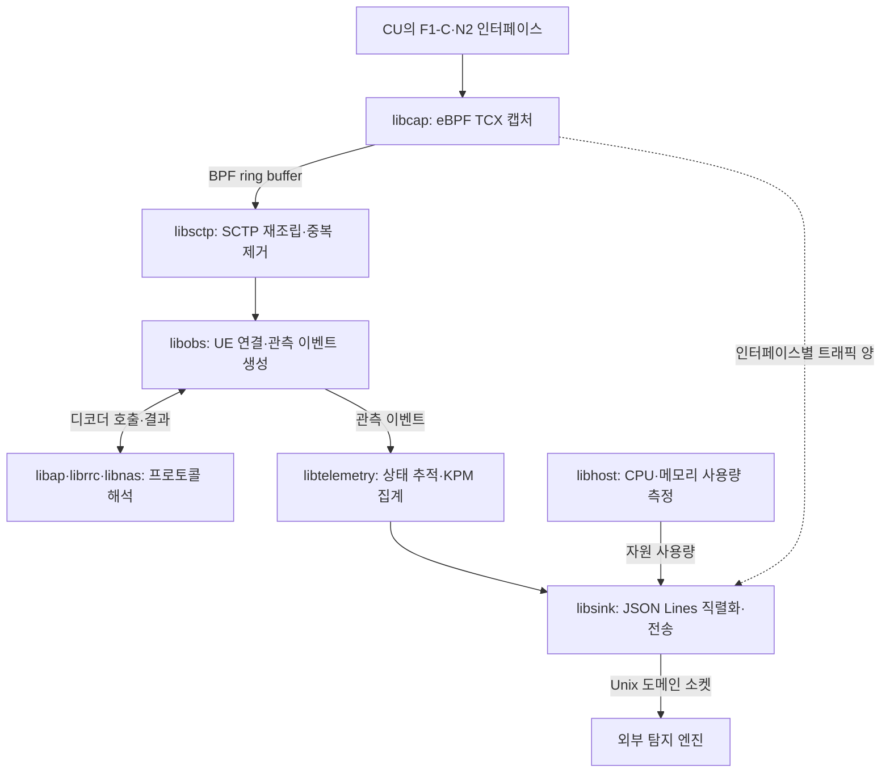

# PortRAN Telemetry

### 5G vRAN 제어평면 기반 이상 탐지를 위한 eBPF 계측 및 분석 엔진

PortRAN Telemetry는 5G vRAN 환경에서 제어평면 트래픽을 관측하고, 이상 탐지에 필요한 UE별 이벤트와 셀별 지표를 생성하는 C 기반 계측 및 분석 엔진입니다. CU에서 eBPF로 F1-C와 N2 트래픽을 수집한 뒤, SCTP 메시지 재조립과 F1AP·NGAP·RRC·NAS 해석을 거쳐 제어 메시지의 의미와 상태 변화를 추적합니다.

본 프로젝트는 [TELERAN 논문](https://www.ndss-symposium.org/wp-content/uploads/futureg26-40.pdf)의 **Table I 보안 텔레메트리와 Table II KPM을 구현 대상으로 삼습니다.** 생성한 데이터를 외부 탐지 엔진에 전달해 제어평면 메시지 순서, 보안 설정, 연결 수립 동작 등에 대한 분석을 지원합니다.

## 1. 프로젝트 목적과 범위

제어평면 기반 탐지에는 패킷의 수뿐 아니라 **어떤 UE가 어떤 메시지를 보냈고, 어떤 보안 설정과 연결 상태를 거쳤는지**에 대한 정보가 필요합니다. PortRAN Telemetry는 표준 인터페이스를 관측해 이 정보를 구성하고, 탐지 엔진이 소비할 수 있는 형태로 전달합니다.

전체 프로젝트의 목적은 5G vRAN 제어평면 기반 이상 탐지이며, `telemetry/`는 다음 과정을 담당합니다.

- **수집:** CU의 네트워크 인터페이스에서 eBPF로 트래픽을 관측합니다.
- **복원·해석:** SCTP 조각을 메시지로 재조립하고 제어평면 프로토콜의 필드를 추출합니다.
- **추적·집계:** UE 식별자와 상태를 연결하고, 셀별 연결 수립·실패·연결 수 지표를 계산합니다.
- **전달:** UE 이벤트와 주기 집계를 JSON Lines로 직렬화해 외부 탐지 엔진으로 보냅니다. 엔진 자신의 CPU·메모리 사용량과 관측 인터페이스의 트래픽 양도 같은 경로로 보냅니다.

공격 판정 규칙과 경보 생성은 연결된 탐지 엔진의 역할입니다. 이 저장소가 제공하는 데이터 경로는 Unix 도메인 소켓이며, E2AP·E2SM-KPM·O1을 통한 RIC 연동은 현재 구현 범위에 포함하지 않습니다.

## 2. 빌드와 실행

**이 프로젝트는 Linux 기반 CU(Central Unit) 호스트에서 텔레메트리 엔진을 빌드하고 실행합니다.** CU는 DU와 F1-C로, 5G 코어의 AMF와 N2로 통신합니다. 엔진은 CU에서 두 구간의 IPv4/SCTP 트래픽을 함께 수집해 같은 단말의 F1AP·NGAP 메시지를 연결합니다. 개발과 통합 시험은 Ubuntu 24.04(Linux 커널 7.0, libbpf 1.3.0, clang 18.1.3, bpftool 7.7.0, GNU make 4.3, GCC 13.3.0)에서 진행했습니다.

### 빌드

| 용도 | 필요한 도구 |
|---|---|
| C 컴파일·링크 | C11 컴파일러, GNU make 4.0 이상, `ar`와 링커 |
| eBPF 프로그램과 로더 | BPF 타깃을 지원하는 `clang`, `llvm-objdump`, `bpftool`, Linux UAPI 헤더, TCX API를 지원하는 `libbpf` 개발 파일. `pkg-config`로 libbpf의 빌드 경로를 찾습니다. |
| ASN.1 디코더 생성 | Git, Autoconf, Automake, Libtool, Bison, Flex, `patch`, `sha256sum` |

CU에서 프로젝트의 최상위 `Makefile`이 있는 디렉터리로 이동한 뒤 실행합니다. 빌드는 일반 사용자 권한으로 할 수 있습니다.

```sh
make
```

기본 빌드는 실행 파일 `build/portran`과 공유 라이브러리 `build/portran-telemetry.so`를 생성합니다. 첫 빌드에서는 지정된 Git 저장소에서 고정 커밋의 `asn1c` 소스를 받아 디코더를 생성하므로 해당 저장소에 접근할 수 있어야 합니다. 필요한 산출물만 빌드할 때는 `make portran`, `make portran-telemetry`, `make asn1` 중 하나를 실행합니다. [빌드 규칙](Makefile) · [ASN.1 디코더 빌드](asn1/README.md)

### CU에서 실행

CU의 Linux 커널은 TCX, BPF ring buffer, `bpf_ktime_get_tai_ns`를 지원해야 합니다. 아래 명령은 eBPF 프로그램을 로드하고 인터페이스에 부착하기 위해 `sudo`로 실행합니다.

1. CU에서 접근할 수 있는 Unix 도메인 소켓에서 탐지 엔진이 수신하도록 실행합니다. 기본 경로는 `/run/ran-detect/kpm.sock`입니다. 수신기가 다른 경로를 사용하면 실행 명령에 `--sock`으로 같은 경로를 지정합니다.
2. CU에서 `ip route get <DU의 F1-C 주소>`와 `ip route get <AMF의 N2 주소>`를 실행합니다. 각 결과의 `dev` 뒤에 표시된 인터페이스 이름을 각각 `F1_IFACE`와 `N2_IFACE`에 넣습니다. 두 경로가 같은 인터페이스를 사용하면 두 변수에 같은 이름을 넣습니다. 프로젝트 통합 시험에서는 F1-C가 CU의 `ens5`를, N2가 컨테이너의 AMF로 연결되는 Docker 브리지를 지났습니다.
3. 확인한 이름으로 아래 변수를 설정한 뒤 CU의 프로젝트 루트에서 실행합니다.

```sh
F1_IFACE='<F1-C 인터페이스 이름>'
N2_IFACE='<N2 인터페이스 이름>'
sudo ./build/portran -g 100 "f1:$F1_IFACE" "n2:$N2_IFACE"
```

`f1:`과 `n2:`는 모두 필수입니다. 예시의 `-g 100`은 100ms마다 셀별 KPM을 보고하는 설정입니다. `RRCSetup`을 본 뒤 `RRCSetupComplete`를 기다리는 무응답 대기 시간은 별도로 기본 1000ms입니다.

| 옵션 | 의미 | 기본값 |
|---|---|---|
| `-g <ms>` | 셀별 KPM 보고 주기 | `900000`ms(15분) |
| `--sock <path>` | 탐지 엔진의 Unix 도메인 소켓 경로 | `/run/ran-detect/kpm.sock` |
| `--record <path>` | 소켓에 전송한 JSON Lines를 파일에도 기록. `--record -`는 표준 출력에 기록 | 기록 안 함 |
| `--node <id>` | `hello`에 포함할 노드 식별자 | 생략 시 `node_id` 필드 생략 |
| `--overhead-ms <ms>` | 자원 사용량 줄(`overhead`) 하나가 다루는 구간. 100~86400000 | `3000`ms |

수신기에서 `hello`의 `period_ms`로 보고 주기를 확인할 수 있습니다. `Ctrl+C`를 한 번 누르면 캡처 탭을 분리하고 버퍼에 남은 레코드를 처리한 뒤 종료합니다. 종료 시 표준 오류에 출력되는 계층별 통계와 종료 코드를 함께 확인합니다.

| 종료 코드 | 의미 |
|---|---|
| `0` | 정상 종료. 프로그램의 관측 범위 검사 통과 |
| `1` | 캡처 탭, 통계 조회, 출력 스트림 등 운영 오류 |
| `2` | 실행 인자가 잘못됐거나, 측정은 돌았지만 관측·전달이 불완전함 |

종료 코드 `2`에는 선언한 인터페이스에서 F1AP나 NGAP를 한 건도 보지 못한 경우, 해석하지 못한 메시지가 있는 경우, 소켓이 연결되지 않아 내보내지 못하고 버린 줄이 있는 경우가 포함됩니다. 탐지 엔진이 수신하기 전에 실행해 그동안 나갈 줄을 버렸다면 `2`로 끝납니다. 어느 경우였는지는 종료 시 표준 오류의 진단에 나옵니다.

## 3. 시스템 구조

### 관측 위치



RRC 메시지는 F1AP의 RRC 컨테이너를 통해 관측합니다. 초기 NAS는 RRCSetupComplete에서 읽고, 이후 NAS는 NGAP의 NAS-PDU를 통해 관측합니다. 각 경로에서 내용을 읽을 수 있는지는 보안 상태와 관측 이력에 따라 달라집니다.

### 처리 파이프라인



| 모듈 | 역할 |
|---|---|
| `libcap` | TCX ingress/egress에 eBPF 프로그램을 부착하고 IPv4/SCTP 패킷을 ring buffer로 전달. 인터페이스·방향별 SCTP 패킷 수와 바이트 수 집계 |
| `libsctp` | DATA 청크 번들링 처리, 단편 재조립, TSN 기반 재전송 중복 제거, 연결 수명 추적 |
| `libap` | F1AP·NGAP에서 UE 식별자, 셀 정보, RRC·NAS 컨테이너, 절차 정보를 추출 |
| `librrc` | RRC 채널과 캡슐화 형태에 맞춰 메시지를 해석하고 식별자·알고리즘·원인 등을 추출 |
| `libnas` | NAS 헤더와 메시지 종류, 임시 식별자, 보안 알고리즘 등의 필드를 해석 |
| `libobs` | F1·N2 UE 레코드 관리, 두 구간의 UE 연결, 메시지 가시성 판단, 관측 이벤트 생성 |
| `libtelemetry` | UE 상태 추적, 셀별 카운터·표본 집계, 주기 보고 및 이벤트 출력 구성 |
| `libhost` | procfs에서 노드와 엔진 프로세스의 구간별 CPU·메모리 사용량 측정 |
| `libsink` | 출력 유효성 검사, JSON Lines 직렬화, 소켓 전송·재접속, 선택적 파일 기록 |

전체 연결과 종료 처리는 [main.c](main.c)가 담당합니다. 현재 파이프라인은 단일 스레드에서 콜백으로 연결됩니다. 자원 사용량은 패킷 경로와 별개로, main.c가 구간 경계마다 `libhost`의 측정값과 `libcap`의 인터페이스 계수기를 읽어 `libsink`로 넘깁니다.

## 4. 주요 기능

### 기존 RAN 트래픽의 수동 관측

캡처 프로그램은 패킷을 읽어 복사본을 만들고 `TCX_NEXT`를 반환합니다. 기존 RAN 소스에 계측 코드를 삽입하는 대신, CU의 네트워크 인터페이스에 관측 프로그램을 부착하는 방식입니다. 빌드 시 [check_readonly.sh](tools/check_readonly.sh)가 BPF 헬퍼 허용 목록과 반환값 등을 검사합니다.

커널에서는 IPv4/SCTP를 선별하고, 사용자 공간에서는 SCTP PPID를 기준으로 F1AP와 NGAP를 구분합니다. 현재 구현의 캡처 훅은 **TCX**입니다.

### 메시지 복원과 표준 문법 기반 해석

한 SCTP 패킷에 여러 메시지가 실리거나, 한 메시지가 여러 DATA 청크로 나뉘어 전송될 수 있습니다. `libsctp`는 메시지를 먼저 복원하고 재전송 중복을 제거해 상위 계층의 이중 집계를 줄입니다.

F1AP·NGAP·RRC는 3GPP ASN.1 문법으로 생성한 디코더를 사용합니다. NAS는 별도의 바이트 파서로 처리합니다.

| 프로토콜 | 사용 문법·규격 | 부호화·해석 방식 |
|---|---|---|
| F1AP | TS 38.473 V18.8.0 | APER / asn1c 생성 디코더 |
| NGAP | TS 38.413 V15.8.0 | APER / asn1c 생성 디코더 |
| NR RRC | TS 38.331 V17.3.0 | UPER / asn1c 생성 디코더 |
| NAS | TS 24.501 기반 파서 | 메시지 바이트 직접 해석 |

문법 출처와 해시, 고정한 asn1c 커밋, 패치와 생성 과정은 [ASN.1 문서](asn1/README.md)에 정리돼 있습니다.

### F1과 N2의 UE 연결

동일 UE도 F1과 N2에서 서로 다른 식별자를 사용합니다. `libobs`는 셀, 수립 원인, NAS 길이·해시와 시간창을 이용해 두 구간의 UE 정보를 연결합니다. 기본 매칭 시간창은 100ms입니다.

### 관측 한계의 구분

수동 관측자는 유실되거나 암호화된 메시지를 다시 요청할 수 없습니다. 따라서 측정값 `0`, 출력값 `null`, 내부 `UNKNOWN` 상태를 구분합니다. 직접 관측한 값과 추론한 값도 내부에서 구별합니다.

다만 이 구분이 모두 JSON 필드로 전달되는 것은 아닙니다. 현재 출력 규약에 없는 일부 품질 정보와 미상·제외 건수는 내부 통계나 종료 진단으로 관리합니다.

## 5. TELERAN Table I·II와의 대응

[TELERAN Table I·II](https://www.ndss-symposium.org/wp-content/uploads/futureg26-40.pdf)는 각각 보안 텔레메트리 10종과 KPM 14종을 제시합니다. 본 구현은 이 항목들을 목표로 하며, 아래 표는 코드에서 추출·추적하는 정보와 실제 출력 범위를 함께 설명합니다.

### Table I — 보안 텔레메트리

| 논문 항목 | 현재 구현 | 외부 출력·제약 |
|---|---|---|
| UE C-RNTI | F1AP에서 추출하고 UE 레코드에 유지 | UE 이벤트의 `crnti`. 모르면 `null` |
| UE S-TMSI | RRC·NAS에서 추출. 내부에서 RRC Part1·Part2 결합 | 메시지별 `s_tmsi` 또는 `s_tmsi_part2`. RRCSetupRequest의 Part1은 `f.ue_identity`. 내부에서 결합한 값이 모든 줄에 반복 출력되지는 않음 |
| UE Cipher Algorithm | RRC 보안 알고리즘 추출·기억 | 해당 메시지의 `f.cipher` |
| UE Integrity Algorithm | RRC 무결성 알고리즘 추출·기억 | 해당 메시지의 `f.integrity` |
| UE RRC State | 내부 UE 레코드에서 상태 추적 | 현재 `ue_evt`에 상태 스냅샷 필드는 없음 |
| UE NAS State | 내부 5GMM 상태·연결 모드 추적 | 현재 `ue_evt`에 상태 스냅샷 필드는 없음 |
| UE RRC Security State | 보안 명령·완료·실패 등으로 내부 상태 갱신 | 가시성 판단·상태 추적에 사용. 별도 상태 필드 출력 없음 |
| UE NAS Security State | NAS 보안 헤더와 메시지로 내부 상태 갱신 | 이벤트에는 `sht`와 해석 가능한 메시지 정보 출력 |
| RRC Message ID | RRC 메시지 종류 해석 | 지원하는 이벤트의 `msg`에 메시지 이름 출력 |
| NAS Message ID | 읽을 수 있는 NAS 메시지 종류 해석 | 지원하는 5GMM 메시지 이름 출력. 종류를 모르는 보호 메시지는 `ProtectedNAS`로 구분 |

현재 외부 출력은 **UE 메시지별 이벤트 스트림**입니다. Table I의 모든 속성과 상태를 한 번에 제공하는 UE 스냅샷 API와는 구분해야 합니다.

### Table II — KPM

지표 14종은 [metrics.h](src/libtelemetry/metrics.h)에 정의돼 있습니다. 현재 `kpm2`는 8종에 대해 관측 조건에 따라 값을 제공하며, 나머지 6종은 `null`로 전달합니다.

| KPM | 종류 | 현재 주기 출력 |
|---|---|---|
| `RRC.ConnEstabAtt` | CC | 연결 수립 시도를 원인별 집계 |
| `RRC.ConnEstabSucc` | CC | 연결 수립 성공을 원인별 집계 |
| `RRC.ConnEstabFailCause` | CC | `NetworkReject`·`NoReply`·`Other` 집계 |
| `RRC.RelWithoutSuspendConfig` | CC | suspendConfig 없는 RRCRelease 집계 |
| `UECNTX.ConnEstabAtt` | CC | N2 관측 시 INITIAL UE MESSAGE 기반 집계 |
| `UECNTX.ConnEstabSucc` | CC | N2 관측 시 UE에 대한 첫 AMF 하행 관측 기반 집계 |
| `RRC.ReEstabAtt` | CC | `null` |
| `RRC.ReEstabSuccWithUeContext` | CC | `null` |
| `RRC.ResumeAtt` | CC | `null` |
| `RRC.ResumeSucc` | CC | `null` |
| `RRC.ConnMean` | SI | 연결 수 표본의 평균. 표본·관측 조건이 유효할 때 제공 |
| `RRC.ConnMax` | SI | 연결 수 표본의 최댓값. 표본·관측 조건이 유효할 때 제공 |
| `RRC.InactiveConnMean` | SI | `null` |
| `RRC.InactiveConnMax` | SI | `null` |

CC는 보고 구간 안의 카운터이며, SI는 표본 기반 지표입니다. 현재 연결 수 표본은 100ms 간격으로 수집합니다. 보고 주기는 `-g`로 별도 설정합니다. 단, `hello`의 `si_sample_ms`는 현재 `period_ms`와 같은 값으로 나가므로 `-g`가 100이 아니면 이 표본 간격과 다릅니다.

재수립·재개 완료와 INACTIVE 상태의 소멸은 암호 구간에서 충분히 관측하기 어렵습니다. 시도만 세고 성공을 `0`으로 보내면 전부 실패한 것으로 읽힐 수 있으므로, 현재는 관련 지표를 함께 보류합니다. 내부에서 처리하거나 센 정보가 있어도 `kpm2` 숫자값 제공을 의미하지는 않습니다.

Table II 외에 `ext.UeCtxMax`, `ext.DuCannotServe`, `ext.CrntiAlloc`도 전달합니다. 각각 구간 내 UE 컨텍스트 수의 최댓값, DU to CU RRC Container가 없는 INITIAL UL 건수, INITIAL UL 건수에 대응합니다. 마지막 값은 실제 C-RNTI 할당량을 직접 읽은 값과 구분해야 합니다.

지표 이름과 집계 설계는 TS 28.552를 바탕으로 합니다.

## 6. 출력 형식

출력은 JSON 객체 하나를 한 줄에 쓰는 **JSON Lines** 형식입니다. 기본 전송 경로는 Unix 도메인 소켓 `/run/ran-detect/kpm.sock`입니다.

| `type` | 내용 |
|---|---|
| `hello` | 접속 시 세션, 보고 주기, 무응답 대기 시간 등 전달 |
| `ue_evt` | UE별 RRC·NAS·일부 F1AP 메시지와 추출 필드 |
| `f1_evt` | F1 Setup·Reset 및 대상 셀·UE 범위 |
| `kpm2` | 셀별 보고 구간의 CC·SI·확장 지표 |
| `overhead` | 구간별 노드·엔진 프로세스의 CPU·메모리 사용량과 인터페이스별 SCTP 패킷·바이트 수 |

모든 줄은 `type`, `ver`, `session`, `seq`를 포함합니다. `session`은 프로세스 기동 시각 기반 식별자이며, `seq`는 세션 내 순번입니다. 시간값은 Unix epoch 밀리초를 사용합니다.

다음은 필드 구성을 보여 주는 합성 예시입니다. 실제 캡처 결과나 탐지 검증용 재생 데이터가 아닙니다. 줄 종류마다 하나씩 고른 것이며 연속된 스트림은 아닙니다.

```jsonl
{"type":"hello","ver":1,"session":"20261113T000000Z","seq":1,"producer":"PortRAN","node_id":"cu-example","period_ms":100,"noreply_timeout_ms":1000,"si_sample_ms":100,"clock":"realtime","ue_evt":true}
{"type":"ue_evt","ver":1,"session":"20261113T000000Z","seq":2,"t_ms":1794528000110,"cell_id":1,"du_ue_id":7,"crnti":17911,"dir":"UL","proto":"RRC","msg":"RRCSetupRequest","f":{"est_cause":"mo-Signalling","ue_identity":{"type":"randomValue"}}}
{"type":"kpm2","ver":1,"session":"20261113T000000Z","seq":3,"cell_id":1,"t_start_ms":1794528000100,"t_end_ms":1794528000200,"cc":{"RRC.ConnEstabAtt":{"total":1,"mo-Signalling":1},"RRC.ConnEstabSucc":{"total":0},"RRC.ConnEstabFailCause":{"NetworkReject":0,"NoReply":0,"Other":0},"RRC.RelWithoutSuspendConfig":0,"UECNTX.ConnEstabAtt":null,"UECNTX.ConnEstabSucc":null,"RRC.ReEstabAtt":null,"RRC.ReEstabSuccWithUeContext":null,"RRC.ResumeAtt":null,"RRC.ResumeSucc":null},"si":{"RRC.ConnMean":0,"RRC.ConnMax":0,"RRC.InactiveConnMean":null,"RRC.InactiveConnMax":null},"ext":{"UeCtxMax":1,"DuCannotServe":0,"CrntiAlloc":1},"ue_evt_lost":[]}
{"type":"overhead","ver":1,"session":"20261113T000000Z","seq":118,"node_id":"cu-example","process_scope":"self","t_start_ms":1794528006000,"t_end_ms":1794528009000,"cpu":{"count":4,"node_busy_cores":0.412,"process_cores":0.012},"memory":{"total_bytes":8105213952,"used_bytes":3241357312,"process_rss_bytes":12328960},"link":[{"interface_name":"ens5","role":"f1","ingress":{"sctp_packet_count":14,"wire_byte_count":2212},"egress":{"sctp_packet_count":13,"wire_byte_count":1906}},{"interface_name":"br-0123456789ab","role":"n2","ingress":{"sctp_packet_count":9,"wire_byte_count":1430},"egress":{"sctp_packet_count":9,"wire_byte_count":1518}}]}
```

출력값을 읽을 때는 다음 차이를 구분해야 합니다.

- **`0`:** 해당 지표의 집계 결과가 0입니다. 관측의 완전성 전체를 보증하는 값은 아닙니다.
- **`null`:** 현재 측정·제공 조건을 충족하지 못한 값입니다. 실패 건수나 정상 상태를 뜻하지 않습니다.
- **필드 생략:** 메시지에 적용되지 않거나 값을 얻지 못한 선택 필드입니다. 구체적인 의미는 해당 필드 규약을 따릅니다.

캡처 생존이 확인되지 않은 구간은 `cc`, `si`, `ext` 전체가 `null`입니다. 재접속 시에는 `hello`를 다시 보내며, 연결이 끊긴 동안의 줄은 버리고 별도 큐에 보관하지 않습니다. `--record`는 소켓에 성공적으로 보낸 줄을 기록하는 옵션입니다.

`overhead`는 `--overhead-ms` 길이의 구간마다 한 줄씩 나갑니다. `cpu`의 두 값은 구간 동안 사용한 코어 수의 평균이고, `cpu.count`로 나누면 점유율이 됩니다. `memory`는 구간 끝 시점의 값입니다. `process_*` 값은 엔진 프로세스 하나만 잰 것이며(`process_scope`가 `self`), `link`의 패킷·바이트 수는 초당 값이 아니라 그 구간의 증가분입니다. 읽지 못한 값은 `0`이 아니라 `null`이고, 비교할 앞선 읽기가 없는 첫 줄의 `link`도 `null`입니다.

출력 구조는 [report.h](src/common/report.h), 직렬화·전송 동작은 [sink.h](src/libsink/sink.h)와 [sink.c](src/libsink/sink.c)를 참고합니다.

## 7. 디렉터리 구성

```text
telemetry/
├── main.c                    # 파이프라인 연결, 옵션, 수집 루프, 종료 진단
├── Makefile                  # 실행 파일·공유 라이브러리·BPF·디코더 빌드
├── src/
│   ├── common/               # 관측 이벤트와 출력 구조체
│   ├── libcap/               # eBPF 프로그램과 사용자 공간 로더
│   ├── libsctp/              # SCTP 재조립·중복 제거·연결 추적
│   ├── libap/                # F1AP·NGAP 해석
│   ├── librrc/               # RRC 해석
│   ├── libnas/               # NAS 해석
│   ├── libobs/               # UE 연결·가시성 판단·관측 이벤트
│   ├── libtelemetry/         # 상태 추적·KPM 집계
│   ├── libhost/              # CPU·메모리 사용량 측정
│   └── libsink/              # JSON Lines 출력·소켓 전송
├── asn1/                     # 3GPP 문법, asn1c 패치, 생성 규칙
└── tools/check_readonly.sh   # BPF 읽기 전용 동작 검사
```

## 8. 참고 문헌과 상세 문서

- [Towards Bridging the Telemetry Gap for Security Applications in 6G OpenRANs via eBPF](https://www.ndss-symposium.org/wp-content/uploads/futureg26-40.pdf) — TELERAN을 제안한 논문. Table I·II 및 텔레메트리 수집 구조를 참고했습니다.
- 3GPP TS 38.473 — F1AP.
- 3GPP TS 38.413 — NGAP.
- 3GPP TS 38.331 — NR RRC.
- 3GPP TS 24.501 — 5GS NAS.
- 3GPP TS 28.552 — 5G 성능 측정 지표.
- RFC 9260 — SCTP.
